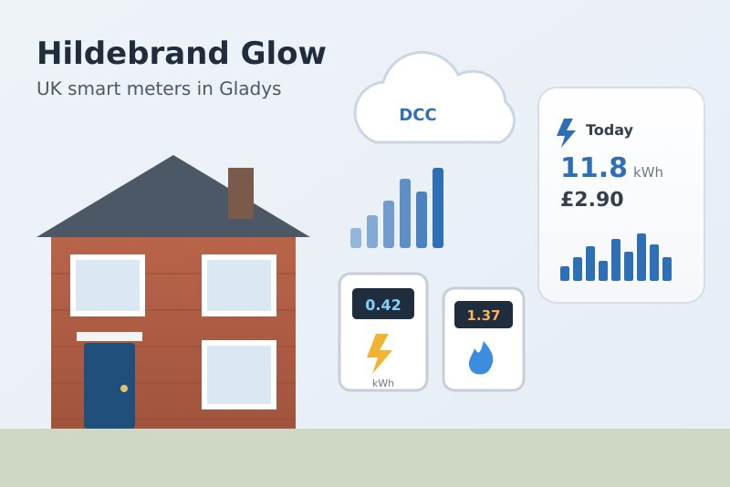
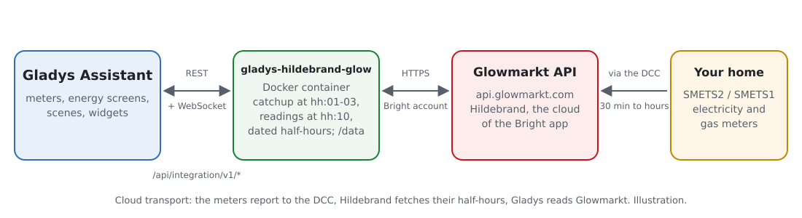
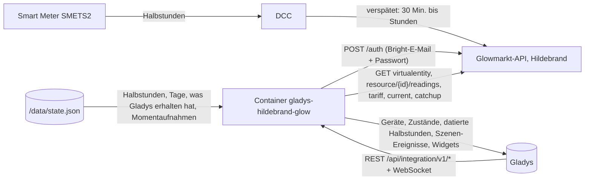
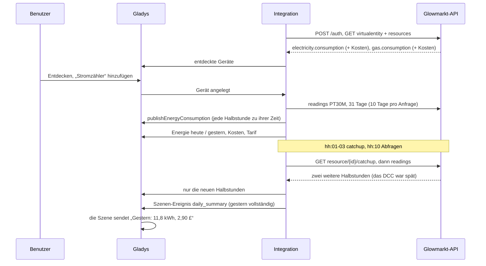
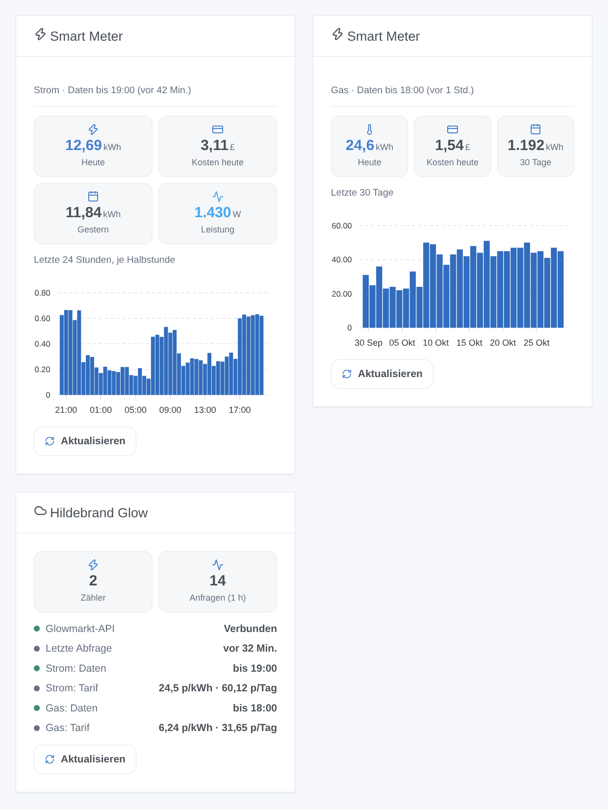

# Gladys Hildebrand Glow (DCC)

[English](README.md) · [Français](README.fr.md) · **Deutsch** · [Español](README.es.md)

[](LICENSE)
[](https://github.com/William-De71/gladys-hildebrand-glow/releases)
[](https://github.com/William-De71/gladys-hildebrand-glow/actions/workflows/release.yml)
[](https://gladysassistant.com)



Externe Integration für [Gladys Assistant](https://gladysassistant.com) für **britische Smart Meter** (SMETS2 und SMETS1 im DCC), gelesen über **Glowmarkt**, die Cloud von Hildebrand hinter der kostenlosen Bright-App. Ein Gerät pro Strom- und Gaszähler mit Energie und Kosten des Tages, dem Tarif und der Momentanleistung mit einem Glow-Display; die Strom-Halbstunden landen zu ihrer tatsächlichen Zeit in den Energieansichten von Gladys, egal wie spät das DCC sie liefert.

Benutzerdokumentation: [English](docs/en.md) · [Français](docs/fr.md) · [Deutsch](docs/de.md) · [Español](docs/es.md).

Nicht mit Hildebrand verbunden. **Noch nicht mit einem echten Bright-Konto getestet**: Die Anfragen folgen den offiziellen Swagger-Dokumenten der Glowmarkt-API; die Formate wurden mit [pyglowmarkt](https://github.com/cybermaggedon/pyglowmarkt) und der benutzerdefinierten Home-Assistant-Integration [ha-hildebrandglow-dcc](https://github.com/HandyHat/ha-hildebrandglow-dcc) abgeglichen.

## Funktionen

- **Ein Gerät pro Zähler** (Strom, Gas): Energie und Kosten von heute und gestern, Arbeitspreis und Grundpreis in Pfund, und die **Leistung**, wenn das Konto ein Glow-Display (IHD oder CAD) hat.
- **Datierte Halbstunden**: Die Strom-Halbstunden gehen mit `publishEnergyConsumption` zu ihrer tatsächlichen Zeit in die Energieansichten von Gladys, nie als Zählerstand (ein verspäteter Zählerstand würde Stunden an Verbrauch in eine einzige Halbstunde packen); eine korrigierte Halbstunde wird erneut veröffentlicht; bis zu 90 Tage Verlauf beim Hinzufügen des Zählers.
- **Ein sparsamer Takt**: ein `catchup` je Zähler kurz nach jeder Halbstunde (wie es die Glowmarkt-Dokumentation verlangt, abschaltbar), die Abfragen 10 Minuten später, Zähler und Tarife alle 6 Stunden; 429 und Ausfälle verlangsamen den Takt, statt zu drängen.
- **4 Szenen-Auslöser**, **2 Szenen-Aktionen**, **2 Dashboard-Widgets** (unten) und eine Schaltfläche **Verbindung testen**.
- Überall vier Sprachen: Englisch, Französisch, Deutsch, Spanisch.

## Funktionsweise





Vom Zähler zur Szene:



### Transport

`transports: ["cloud"]`: Jede Anfrage geht mit dem Bright-Konto an `api.glowmarkt.com`; die öffentliche `applicationId` der Bright-App kennzeichnet den Client, wie in der Glowmarkt-Dokumentation. Die Daten kommen vom DCC, 30 Minuten bis einige Stunden verzögert. Ein Glow-Display hat außerdem einen lokalen MQTT-Datenstrom, der hier nicht genutzt wird. `/data` speichert die Halbstunden der letzten 3 Tage, die Tage der letzten 70, die bereits an Gladys übergebenen Halbstunden und die Werte, die die Szenen-Auslöser vergleichen.

## Geräte und Funktionen

| Funktion                | Kategorie / Typ                                | Einheit   | Vorhanden, wenn          |
| ----------------------- | ---------------------------------------------- | --------- | ------------------------ |
| Verbrauch (Halbstunden) | `energy-sensor` / `thirty-minutes-consumption` | kWh       | Stromzähler              |
| Energie heute           | `energy-sensor` / `index-today`                | kWh       | immer                    |
| Energie gestern         | `energy-sensor` / `index-yesterday`            | kWh       | immer                    |
| Kosten heute / gestern  | `currency` / `decimal`                         | £         | das Konto hat Kosten     |
| Arbeitspreis            | `currency` / `decimal`                         | £ pro kWh | Bright kennt einen Tarif |
| Grundpreis              | `currency` / `decimal`                         | £ pro Tag | Bright kennt einen Tarif |
| Leistung                | `energy-sensor` / `power`                      | W         | Strom, ein Glow-Display  |

Alle Funktionen sind schreibgeschützt. Gladys fügt die Kosten des 30-Minuten-Verbrauchs selbst hinzu, nach Ihrem Energievertrag. Der Gaszähler hat keine Verbrauchsfunktion: Gladys hängt jeden Verbrauch an den Haupt-Stromzähler. Die API liefert Kosten in Pence, veröffentlicht werden sie in Pfund.

## Szenen-Auslöser, Aktionen und Widgets



Widgets:

- **Smart Meter**: Energie und Kosten von heute, gestern (oder 7 / 30 Tage), Leistung, Balkendiagramm je Halbstunde (24 h) oder je Tag (7 / 30 Tage), Verzögerung der Daten, **Aktualisieren**. Einstellungen: der Zähler, das Diagramm.
- **Hildebrand Glow**: Verbindung, wie weit die Daten jedes Zählers reichen, Tarife, Anfragen der letzten Stunde, **Aktualisieren**.

Szenen-Auslöser (gefiltert nach Zähler und Energieart): die Zahlen von gestern liegen vor (Energie, Kosten, vollständig), der Tarif ändert sich (neuer und vorheriger Arbeits- und Grundpreis), ein Zähler sendet keine Daten mehr (12 Stunden), ein Zähler sendet wieder Daten.

Szenen-Aktionen: Energie und Kosten eines Zeitraums (heute … letzter Monat), Zähler jetzt abfragen (Energie und Kosten von heute, Uhrzeit der neuesten Daten).

Beispiele:

- Wenn die Zahlen von gestern vorliegen → „Gestern: {{triggerEvent.data.energy_kwh}} kWh, {{triggerEvent.data.cost}} £“ melden.
- Jeden 1. des Monats → Energie und Kosten des letzten Monats abrufen und senden.
- Wenn ein Zähler keine Daten mehr sendet → melden, die Bright-App zu prüfen.

## Voraussetzungen

- Gladys Assistant **5.3.0** oder neuer (ältere Instanzen können sie nicht installieren).
- Smart Meter im DCC (SMETS2 oder migrierte SMETS1), in der kostenlosen Bright-App verknüpft, mit dort sichtbarem Verbrauch.
- Optional: ein Glow-Display (IHD oder CAD) für die Momentanleistung.

## Installation

- **Aus dem Store**: Integrationen → Hildebrand Glow (DCC) → Installieren.
- **Über die Repository-URL**: Integrationen → externe Integration → `https://github.com/William-De71/gladys-hildebrand-glow`.
- **Entwicklermodus**: `npm start` mit den von Gladys gelieferten Variablen starten (siehe Entwicklung).

## Konfiguration

| Feld oder Schaltfläche        | Standard    | Bedeutung                                                                      |
| ----------------------------- | ----------- | ------------------------------------------------------------------------------ |
| E-Mail des Bright-Kontos      | —           | Pflichtfeld                                                                    |
| Passwort                      | —           | Pflichtfeld, ein Geheimnis: nie wieder angezeigt, nie protokolliert            |
| Abfrage der Halbstunden       | 30 Min.     | 30 oder 60 Minuten                                                             |
| Abfrage der Leistung          | 2 Min.      | 1, 2, 5 oder 10 Minuten, nur mit einem Glow-Display                            |
| An Gladys übergebener Verlauf | 31 Tage     | 0, 7, 31 oder 90 Tage, einmal pro hinzugefügtem Zähler                         |
| Neueste Daten anfordern       | an          | Ein `catchup` je Zähler kurz nach jeder Halbstunde                             |
| Sprache der Gerätetexte       | automatisch | Namen der Zähler und Funktionen, Meldungen der Schaltfläche                    |
| Verbindung testen             | —           | Meldet sich an, liest die Zähler jetzt und listet sie mit ihren neuesten Daten |

## Verwendung

1. E-Mail und Passwort des Bright-Kontos eingeben, dann **Verbindung testen** drücken (Integrationen → Hildebrand Glow (DCC) → Konfiguration).
2. **Entdecken**, dann die gewünschten Zähler als Geräte hinzufügen.
3. Die Widgets **Smart Meter** und **Hildebrand Glow** zu einem Dashboard hinzufügen; die Energieansichten von Gladys zeigen die Strom-Halbstunden.
4. Szenen mit den Gerätefunktionen, den Auslösern und den Aktionen erstellen.

## Entwicklung

```bash
npm install
npm test                       # node --test, never touches the network
npm run lint                   # ESLint
npm run format:check           # Prettier
npx github:GladysAssistant/integration-store . --skip-image-check
scripts/build-cover.sh         # cover.jpg from docs/assets/cover.svg
docs/illustrations/render.sh   # docs/assets/widgets.<lang>.png
```

Lokal liest das SDK `GLADYS_HOST_API_URL`, `GLADYS_INTEGRATION_TOKEN` und `GLADYS_INTEGRATION_SELECTOR` (von Gladys im Entwicklermodus geliefert), und die Integration liest `TZ` (die Tage; ohne Angabe Europe/London). `DEBUG=gladys-integration-sdk` zeigt die SDK-Protokolle.

Die Tests decken den API-Client ab (Anmeldung, Header, Token-Erneuerung nach `exp`, 401 und das 404 eines unbekannten Tokens, 429 mit Retry-After, 5xx, Netzwerkfehler, die Abfrage der Werte, die Warteschlange), das Datenmodell (Zähler nach Classifier, Londoner Tage und Zeitumstellungen, Nulls, 10-Tage-Abschnitte, beide Tarifformen, Momentanleistung), die Geräte (die von Entdecken verlangten Felder, Kategorie-/Typ-Paare, kein Zählerstand, kein Gasverbrauch), die Szenen-Auslöser, die Widgets (`validateWidgetContent`), das Manifest, die vier Sprachen, das Release-Skript und die ganze Integration gegen das falsche Gladys des SDK und eine falsche API (Zeitplan, Verlauf, datierte Halbstunden, Fehler, Neustart). `test/structure.test.js` friert jeden von Benutzern gespeicherten Schlüssel ein.

## Release-Prozess


Jeder Merge auf `main` startet die CI und berechnet dann die Version aus den [Conventional Commits](https://www.conventionalcommits.org/) seit dem letzten Tag: `feat` → Minor, `fix` / `perf` → Patch, `!` oder `BREAKING CHANGE` → Major (ein Minor vor 1.0.0); `docs`, `chore`, `ci`, `test`, `style`, `refactor`, `build` allein veröffentlichen nichts. Der Changelog-Abschnitt wird erzeugt, der Tag gepusht, das Multi-Architektur-Image gebaut, dann erhält `main` den Release-Commit, die GitHub Release wird angelegt und ein letzter Job prüft das öffentliche Image, den Store-Validator und das Topic.

- Der Titel des Pull Requests wird zum Squash-Commit und dann zur Changelog-Zeile: auf Englisch und für den Benutzer schreiben (`pr-title.yml` prüft ihn). `CHANGELOG.md` nie von Hand bearbeiten.
- 1.0.0 ist eine Entscheidung: Actions → Release → Run workflow mit `release-as: 1.0.0`. `dry-run` zeigt Version und Notizen, ohne etwas zu veröffentlichen.
- **Geschützter Branch**: Das Release pusht seinen Commit mit `GITHUB_TOKEN` auf `main`. Das Ruleset `protect-main` (kein Löschen, kein Force-Push) lässt ihn durch; eine strengere Regel (Pull Request Pflicht, Status-Checks) bräuchte GitHub Actions in ihrer Bypass-Liste oder eine GitHub App.
- Nach dem ersten Release das Paket auf `ghcr.io` öffentlich machen (Package settings → Change visibility), sonst kann Gladys es nicht laden.

## Fehlerbehebung

Siehe [docs/de.md](docs/de.md#fehlerbehebung). Melden Sie Probleme mit den Versionen von Gladys und der Integration, Ihren Zählern (Strom, Gas, SMETS1 / SMETS2, Glow-Display), dem Ergebnis von „Verbindung testen“ und den Protokollen der Integration. Fügen Sie niemals Ihr Passwort ein.

## Mitwirken

Issues und Pull Requests sind willkommen. Führen Sie vor einem Pull Request `npm run format:check && npm run lint && npm test` aus und lassen Sie alle externen IDs und gespeicherten Schlüssel unverändert (siehe [CLAUDE.md](CLAUDE.md)).

## Sicherheit

Siehe [SECURITY.md](SECURITY.md): Schwachstellen bitte privat melden. Das Passwort ist ein `secret`-Feld: nie protokolliert, nie in `/data` geschrieben, nur per HTTPS an `api.glowmarkt.com` gesendet, um ein Token zu erhalten; weder Token noch Passwort erscheinen in einer Fehlermeldung. Eine Änderung des Passworts des Bright-Kontos widerruft den Zugriff sofort.

## Kommende Screenshots

Die Bilder oben sind Illustrationen, keine Screenshots. Echte Screenshots kommen nach `docs/assets/screenshots/` (PNG, 1280 × 800): `configuration.png` (Anmeldung und „Verbindung testen“), `discovery.png`, `device.png` (der Stromzähler), `energy.png` (die Energieansicht von Gladys mit den Halbstunden), `scene.png`.

## Lizenz

[Apache License 2.0](LICENSE) — siehe auch [NOTICE](NOTICE). Hildebrand, Glow, Glowmarkt und Bright sind Marken von Hildebrand Technology Limited. Die API-Fakten stammen aus den offiziellen Glowmarkt-Swagger-Dokumenten, [pyglowmarkt](https://github.com/cybermaggedon/pyglowmarkt) (Apache-2.0), [ha-hildebrandglow-dcc](https://github.com/HandyHat/ha-hildebrandglow-dcc) (MIT) und [glowmarkt-rs](https://github.com/Mossop/glowmarkt-rs) (MIT), in NOTICE genannt; es wurde kein Code kopiert. Danke an die Dokumentation und das SDK von Gladys.
