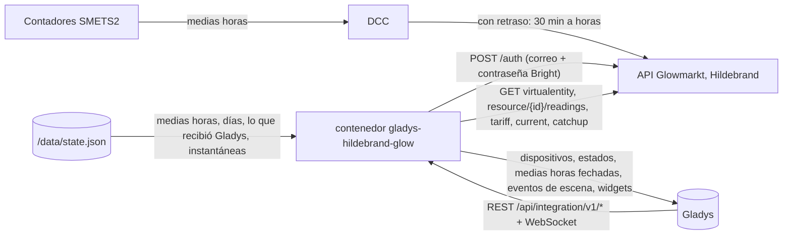
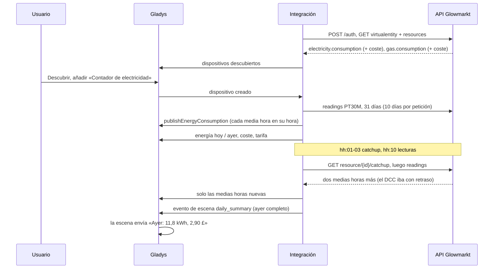
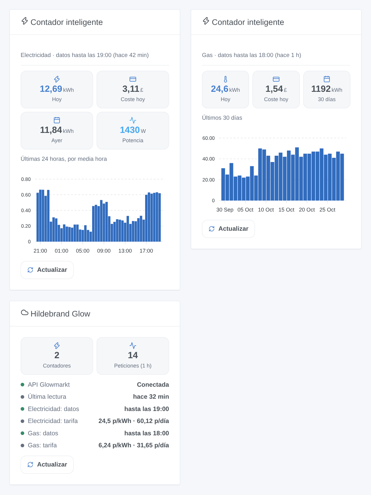

# Gladys Hildebrand Glow (DCC)

[English](README.md) · [Français](README.fr.md) · [Deutsch](README.de.md) · **Español**

[](LICENSE)
[](https://github.com/William-De71/gladys-hildebrand-glow/releases)
[](https://github.com/William-De71/gladys-hildebrand-glow/actions/workflows/release.yml)
[](https://gladysassistant.com)


Integración externa de [Gladys Assistant](https://gladysassistant.com) para los **contadores inteligentes británicos** (SMETS2, y SMETS1 en el DCC), leídos a través de **Glowmarkt**, la nube de Hildebrand detrás de la app gratuita Bright. Un dispositivo por contador de electricidad y de gas con la energía y el coste del día, la tarifa y la potencia instantánea con una pantalla Glow; las medias horas de electricidad llegan a las pantallas de energía de Gladys en su hora real, por mucho que tarde el DCC en entregarlas.

Documentación de usuario: [English](docs/en.md) · [Français](docs/fr.md) · [Deutsch](docs/de.md) · [Español](docs/es.md).

Sin relación con Hildebrand. **Aún no probada con una cuenta Bright real**: las peticiones siguen los documentos Swagger oficiales de la API Glowmarkt; los formatos se han contrastado con [pyglowmarkt](https://github.com/cybermaggedon/pyglowmarkt) y la integración personalizada de Home Assistant [ha-hildebrandglow-dcc](https://github.com/HandyHat/ha-hildebrandglow-dcc).

## Funciones

- **Un dispositivo por contador** (electricidad, gas): energía y coste de hoy y de ayer, precio del kWh y cargo fijo en libras, y la **potencia** cuando la cuenta tiene una pantalla Glow (IHD o CAD).
- **Medias horas fechadas**: las medias horas de electricidad van a las pantallas de energía de Gladys con `publishEnergyConsumption`, en su hora real, nunca como índice (un índice retrasado pondría horas de consumo en una sola media hora); una media hora corregida se vuelve a publicar; hasta 90 días de historial al añadir el contador.
- **Un ritmo ligero**: un `catchup` por contador justo después de cada media hora (como pide la documentación de Glowmarkt, desactivable), las lecturas 10 minutos después, contadores y tarifas cada 6 horas; los 429 y las caídas reducen el ritmo en lugar de insistir.
- **4 disparadores de escena**, **2 acciones de escena**, **2 widgets de panel** (abajo) y un botón **Probar la conexión**.
- Cuatro idiomas en todas partes: inglés, francés, alemán, español.

## Funcionamiento




De un contador a una escena:



### Transporte

`transports: ["cloud"]`: cada petición va a `api.glowmarkt.com` con la cuenta Bright; el `applicationId` público de la app Bright identifica al cliente, como en la documentación de Glowmarkt. Los datos vienen del DCC, con 30 minutos a unas horas de retraso. Una pantalla Glow tiene además un flujo MQTT local, que no se usa aquí. `/data` guarda las medias horas de los últimos 3 días, los días de los últimos 70, las medias horas ya enviadas a Gladys y los valores que comparan los disparadores de escena.

## Dispositivos y funciones

| Función                | Categoría / tipo                               | Unidad    | Presente cuando                 |
| ---------------------- | ---------------------------------------------- | --------- | ------------------------------- |
| Consumo (medias horas) | `energy-sensor` / `thirty-minutes-consumption` | kWh       | contador de electricidad        |
| Energía hoy            | `energy-sensor` / `index-today`                | kWh       | siempre                         |
| Energía ayer           | `energy-sensor` / `index-yesterday`            | kWh       | siempre                         |
| Coste hoy / ayer       | `currency` / `decimal`                         | £         | la cuenta tiene un coste        |
| Precio del kWh         | `currency` / `decimal`                         | £ por kWh | Bright conoce una tarifa        |
| Cargo fijo             | `currency` / `decimal`                         | £ por día | Bright conoce una tarifa        |
| Potencia               | `energy-sensor` / `power`                      | W         | electricidad, una pantalla Glow |

Todas las funciones son de solo lectura. Gladys añade él mismo el coste del consumo de 30 minutos, según su contrato de energía. El contador de gas no tiene función de consumo: Gladys asocia todo consumo al contador eléctrico principal. La API da los costes en peniques y se publican en libras.

## Disparadores, acciones de escena y widgets



Widgets:

- **Contador inteligente**: energía y coste de hoy, de ayer (o de 7 / 30 días), potencia, gráfico de barras por media hora (24 h) o por día (7 / 30 días), retraso de los datos, **Actualizar**. Ajustes: el contador, el gráfico.
- **Hildebrand Glow**: conexión, hasta dónde llegan los datos de cada contador, tarifas, peticiones de la última hora, **Actualizar**.

Disparadores de escena (filtrados por contador y energía): las cifras de ayer están listas (energía, coste, completo), cambia la tarifa (nuevos y anteriores precio del kWh y cargo fijo), un contador deja de enviar datos (12 horas), un contador vuelve a enviar datos.

Acciones de escena: energía y coste de un periodo (hoy … el mes pasado), leer los contadores ahora (energía y coste de hoy, hora de los últimos datos).

Ejemplos:

- Cuando las cifras de ayer están listas → notificar «Ayer: {{triggerEvent.data.energy_kwh}} kWh, {{triggerEvent.data.cost}} £».
- Cada día 1 del mes → obtener la energía y el coste del mes pasado y enviarlos.
- Cuando un contador deja de enviar datos → avisar de que se compruebe la app Bright.

## Requisitos

- Gladys Assistant **5.3.0** o posterior (las instancias anteriores no pueden instalarla).
- Contadores inteligentes en el DCC (SMETS2, o SMETS1 migrados), vinculados en la app gratuita Bright, con el consumo visible en ella.
- Opcional: una pantalla Glow (IHD o CAD) para la potencia instantánea.

## Instalación

- **Desde la tienda**: Integraciones → Hildebrand Glow (DCC) → Instalar.
- **Desde la URL del repositorio**: Integraciones → integración externa → `https://github.com/William-De71/gladys-hildebrand-glow`.
- **Modo desarrollador**: ejecute `npm start` con las variables que da Gladys (ver Desarrollo).

## Configuración

| Campo o botón                            | Por defecto | Significado                                                               |
| ---------------------------------------- | ----------- | ------------------------------------------------------------------------- |
| Correo de la cuenta Bright               | —           | Obligatorio                                                               |
| Contraseña                               | —           | Obligatoria, un secreto: nunca se vuelve a mostrar, nunca se registra     |
| Lectura de las medias horas              | 30 min      | 30 o 60 minutos                                                           |
| Lectura de la potencia                   | 2 min       | 1, 2, 5 o 10 minutos, solo con una pantalla Glow                          |
| Historial enviado a Gladys               | 31 días     | 0, 7, 31 o 90 días, una vez por contador añadido                          |
| Pedir los últimos datos                  | activado    | Un `catchup` por contador justo después de cada media hora                |
| Idioma de los textos de los dispositivos | automático  | Nombres de los contadores y funciones, mensajes del botón                 |
| Probar la conexión                       | —           | Inicia sesión, lee ahora los contadores y los lista con sus últimos datos |

## Uso

1. Introduzca el correo y la contraseña de la cuenta Bright y pulse **Probar la conexión** (Integraciones → Hildebrand Glow (DCC) → Configuración).
2. **Descubrir**, y añada como dispositivos los contadores que desee.
3. Añada los widgets **Contador inteligente** y **Hildebrand Glow** a un panel; las pantallas de energía de Gladys muestran las medias horas de electricidad.
4. Cree escenas con las funciones de los dispositivos, los disparadores y las acciones.

## Desarrollo

```bash
npm install
npm test                       # node --test, never touches the network
npm run lint                   # ESLint
npm run format:check           # Prettier
npx github:GladysAssistant/integration-store . --skip-image-check
scripts/build-cover.sh         # cover.jpg from docs/assets/cover.svg
docs/illustrations/render.sh   # docs/assets/widgets.<lang>.png
```

En local, el SDK lee `GLADYS_HOST_API_URL`, `GLADYS_INTEGRATION_TOKEN` y `GLADYS_INTEGRATION_SELECTOR` (que da Gladys en modo desarrollador), y la integración lee `TZ` (los días; Europe/London si falta). `DEBUG=gladys-integration-sdk` muestra los registros del SDK.

Las pruebas cubren el cliente de la API (inicio de sesión, cabeceras, renovación del token según `exp`, 401 y el 404 de un token desconocido, 429 con Retry-After, 5xx, errores de red, la consulta de lecturas, la cola), el modelo de datos (contadores según los classifiers, días de Londres y cambios de hora, nulls, tramos de 10 días, las dos formas de tarifa, potencia instantánea), los dispositivos (los campos que exige la pantalla Descubrir, pares categoría / tipo, ningún índice, ningún consumo de gas), los disparadores de escena, los widgets (`validateWidgetContent`), el manifiesto, los cuatro idiomas, el script de release y toda la integración frente al falso Gladys del SDK y una API falsa (calendario, historial, medias horas fechadas, errores, reinicio). `test/structure.test.js` congela cada clave que guardan los usuarios.

## Proceso de release


Cada fusión en `main` lanza la CI y luego calcula la versión a partir de los [Conventional Commits](https://www.conventionalcommits.org/) desde la última etiqueta: `feat` → menor, `fix` / `perf` → parche, `!` o `BREAKING CHANGE` → mayor (una menor antes de 1.0.0); `docs`, `chore`, `ci`, `test`, `style`, `refactor`, `build` solos no publican nada. Se genera la sección del changelog, se empuja la etiqueta, se construye la imagen multiarquitectura, después `main` recibe el commit de release, se crea la GitHub Release y un último job comprueba la imagen pública, el validador de la tienda y el topic.

- El título del pull request se convierte en el commit squash y luego en la línea del changelog: escríbalo en inglés, para el usuario (`pr-title.yml` lo comprueba). No edite nunca `CHANGELOG.md` a mano.
- La 1.0.0 es una decisión: Actions → Release → Run workflow con `release-as: 1.0.0`. `dry-run` muestra la versión y las notas sin publicar nada.
- **Rama protegida**: la release empuja su commit a `main` con `GITHUB_TOKEN`. El ruleset `protect-main` (sin borrado, sin force-push) lo deja pasar; una regla más estricta (pull request obligatorio, status checks) necesitaría GitHub Actions en su lista de excepciones, o una GitHub App.
- Tras la primera release, haga público el paquete de `ghcr.io` (Package settings → Change visibility), o Gladys no podrá descargarlo.

## Solución de problemas

Ver [docs/es.md](docs/es.md#solución-de-problemas). Informe de los problemas con las versiones de Gladys y de la integración, sus contadores (electricidad, gas, SMETS1 / SMETS2, pantalla Glow), el resultado de «Probar la conexión» y los registros de la integración. No pegue nunca su contraseña.

## Contribuir

Los issues y pull requests son bienvenidos. Ejecute `npm run format:check && npm run lint && npm test` antes de abrir un pull request y mantenga sin cambios todos los identificadores externos y claves guardadas (ver [CLAUDE.md](CLAUDE.md)).

## Seguridad

Ver [SECURITY.md](SECURITY.md): informe de las vulnerabilidades en privado. La contraseña es un campo `secret`: nunca se registra, nunca se escribe en `/data`, solo se envía a `api.glowmarkt.com` por HTTPS para obtener un token; ni el token ni la contraseña aparecen en un mensaje de error. Cambiar la contraseña de la cuenta Bright revoca el acceso de inmediato.

## Capturas pendientes

Las imágenes de arriba son ilustraciones, no capturas de pantalla. Las capturas reales irán en `docs/assets/screenshots/` (PNG, 1280 × 800): `configuration.png` (inicio de sesión y «Probar la conexión»), `discovery.png`, `device.png` (el contador de electricidad), `energy.png` (la pantalla de energía de Gladys con las medias horas), `scene.png`.

## Licencia

[Apache License 2.0](LICENSE) — ver también [NOTICE](NOTICE). Hildebrand, Glow, Glowmarkt y Bright son marcas de Hildebrand Technology Limited. Los datos de la API proceden de los documentos Swagger oficiales de Glowmarkt, de [pyglowmarkt](https://github.com/cybermaggedon/pyglowmarkt) (Apache-2.0), de [ha-hildebrandglow-dcc](https://github.com/HandyHat/ha-hildebrandglow-dcc) (MIT) y de [glowmarkt-rs](https://github.com/Mossop/glowmarkt-rs) (MIT), acreditados en NOTICE; no se ha copiado código. Gracias a la documentación y al SDK de Gladys.
