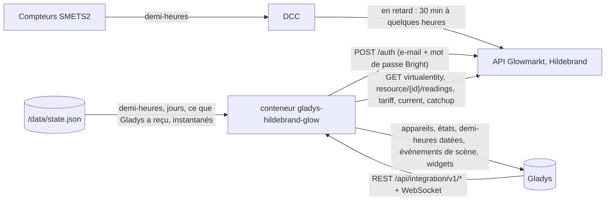
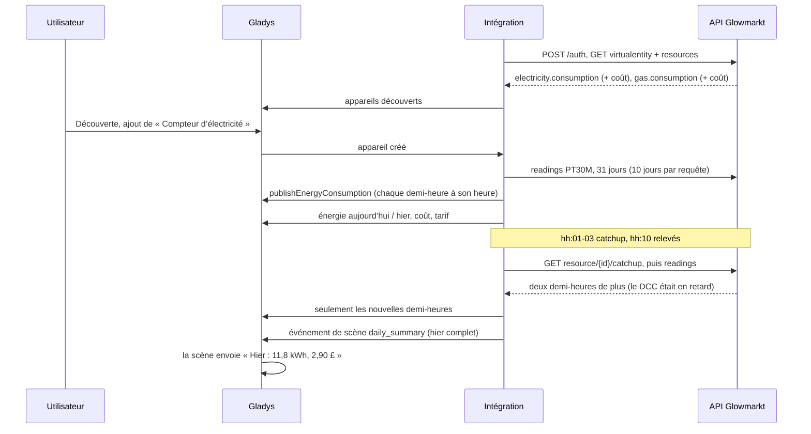
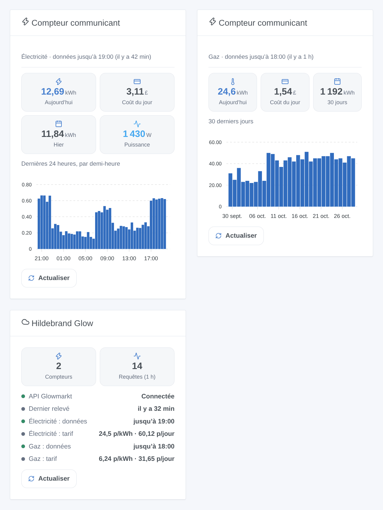

# Gladys Hildebrand Glow (DCC)

[English](README.md) · **Français** · [Deutsch](README.de.md) · [Español](README.es.md)

[](LICENSE)
[](https://github.com/William-De71/gladys-hildebrand-glow/releases)
[](https://github.com/William-De71/gladys-hildebrand-glow/actions/workflows/release.yml)
[](https://gladysassistant.com)


Intégration externe [Gladys Assistant](https://gladysassistant.com) pour les **compteurs communicants britanniques** (SMETS2, et SMETS1 passés au DCC), lus via **Glowmarkt**, le cloud de Hildebrand derrière l’application gratuite Bright. Un appareil par compteur d’électricité et de gaz avec l’énergie et le coût du jour, le tarif et la puissance instantanée avec un afficheur Glow ; les demi-heures d’électricité arrivent dans les écrans énergie de Gladys à leur heure réelle, quel que soit le retard du DCC.

Documentation utilisateur : [English](docs/en.md) · [Français](docs/fr.md) · [Deutsch](docs/de.md) · [Español](docs/es.md).

Non affiliée à Hildebrand. **Pas encore testée avec un vrai compte Bright** : les requêtes suivent les documents Swagger officiels de l’API Glowmarkt ; les formats ont été recoupés avec [pyglowmarkt](https://github.com/cybermaggedon/pyglowmarkt) et l’intégration personnalisée Home Assistant [ha-hildebrandglow-dcc](https://github.com/HandyHat/ha-hildebrandglow-dcc).

## Fonctionnalités

- **Un appareil par compteur** (électricité, gaz) : énergie et coût d’aujourd’hui et d’hier, prix du kWh et abonnement en livres, et la **puissance** si le compte a un afficheur Glow (IHD ou CAD).
- **Demi-heures datées** : les demi-heures d’électricité vont dans les écrans énergie de Gladys avec `publishEnergyConsumption`, à leur heure réelle, jamais sous forme d’index (un index en retard placerait des heures de consommation dans une seule demi-heure) ; une demi-heure corrigée est republiée ; jusqu’à 90 jours d’historique à l’ajout du compteur.
- **Un rythme léger** : un `catchup` par compteur juste après chaque demi-heure (comme le demande la documentation Glowmarkt, désactivable), les relevés 10 minutes plus tard, compteurs et tarifs toutes les 6 heures ; les 429 et les pannes ralentissent le rythme au lieu d’insister.
- **4 déclencheurs de scène**, **2 actions de scène**, **2 widgets de tableau de bord** (ci-dessous) et un bouton **Tester la connexion**.
- Quatre langues partout : anglais, français, allemand, espagnol.

## Fonctionnement




D’un compteur à une scène :



### Transport

`transports: ["cloud"]` : chaque requête part vers `api.glowmarkt.com` avec le compte Bright ; l’`applicationId` public de l’application Bright identifie le client, comme dans la documentation Glowmarkt. Les données viennent du DCC, avec 30 minutes à quelques heures de retard. Un afficheur Glow a aussi un flux MQTT local, non utilisé ici. `/data` garde les demi-heures des 3 derniers jours, les jours des 70 derniers, les demi-heures déjà transmises à Gladys et les valeurs que comparent les déclencheurs de scène.

## Appareils et fonctionnalités

| Fonctionnalité             | Catégorie / type                               | Unité      | Présente si                    |
| -------------------------- | ---------------------------------------------- | ---------- | ------------------------------ |
| Consommation (demi-heures) | `energy-sensor` / `thirty-minutes-consumption` | kWh        | compteur d’électricité         |
| Énergie aujourd’hui        | `energy-sensor` / `index-today`                | kWh        | toujours                       |
| Énergie hier               | `energy-sensor` / `index-yesterday`            | kWh        | toujours                       |
| Coût aujourd’hui / hier    | `currency` / `decimal`                         | £          | le compte a un coût            |
| Prix du kWh                | `currency` / `decimal`                         | £ par kWh  | Bright connaît un tarif        |
| Abonnement                 | `currency` / `decimal`                         | £ par jour | Bright connaît un tarif        |
| Puissance                  | `energy-sensor` / `power`                      | W          | électricité, un afficheur Glow |

Toutes les fonctionnalités sont en lecture seule. Gladys ajoute lui-même le coût de la consommation 30 minutes, d’après votre contrat d’énergie. Le compteur de gaz n’a pas de fonctionnalité de consommation : Gladys rattache toute consommation au compteur électrique principal. Les coûts sont donnés en pence par l’API et publiés en livres.

## Déclencheurs, actions de scène et widgets



Widgets :

- **Compteur communicant** : énergie et coût d’aujourd’hui, d’hier (ou de 7 / 30 jours), puissance, graphique en barres par demi-heure (24 h) ou par jour (7 / 30 jours), retard des données, **Actualiser**. Réglages : le compteur, le graphique.
- **Hildebrand Glow** : connexion, jusqu’où vont les données de chaque compteur, tarifs, requêtes de la dernière heure, **Actualiser**.

Déclencheurs de scène (filtrés par compteur et par énergie) : les chiffres d’hier sont prêts (énergie, coût, complet), le tarif change (nouveaux et précédents prix du kWh et abonnement), un compteur n’envoie plus de données (12 heures), un compteur envoie de nouveau des données.

Actions de scène : énergie et coût d’une période (aujourd’hui … le mois dernier), relever les compteurs maintenant (énergie et coût d’aujourd’hui, heure des dernières données).

Exemples :

- Quand les chiffres d’hier sont prêts → notifier « Hier : {{triggerEvent.data.energy_kwh}} kWh, {{triggerEvent.data.cost}} £ ».
- Chaque 1er du mois → obtenir l’énergie et le coût du mois dernier et les envoyer.
- Quand un compteur n’envoie plus de données → notifier de vérifier l’application Bright.

## Prérequis

- Gladys Assistant **5.3.0** ou plus récent (les instances plus anciennes ne peuvent pas l’installer).
- Des compteurs communicants sur le DCC (SMETS2, ou SMETS1 migrés), reliés dans l’application gratuite Bright, avec la consommation visible.
- Facultatif : un afficheur Glow (IHD ou CAD) pour la puissance instantanée.

## Installation

- **Depuis le store** : Intégrations → Hildebrand Glow (DCC) → Installer.
- **Depuis l’URL du dépôt** : Intégrations → intégration externe → `https://github.com/William-De71/gladys-hildebrand-glow`.
- **Mode développeur** : lancez `npm start` avec les variables données par Gladys (voir Développement).

## Configuration

| Champ ou bouton                 | Défaut      | Signification                                                               |
| ------------------------------- | ----------- | --------------------------------------------------------------------------- |
| E-mail du compte Bright         | —           | Obligatoire                                                                 |
| Mot de passe                    | —           | Obligatoire, un secret : jamais réaffiché, jamais journalisé                |
| Relevé des demi-heures          | 30 min      | 30 ou 60 minutes                                                            |
| Relevé de la puissance          | 2 min       | 1, 2, 5 ou 10 minutes, uniquement avec un afficheur Glow                    |
| Historique transmis à Gladys    | 31 jours    | 0, 7, 31 ou 90 jours, une fois par compteur ajouté                          |
| Demander les dernières données  | activé      | Un `catchup` par compteur juste après chaque demi-heure                     |
| Langue des textes des appareils | automatique | Noms des compteurs et des fonctionnalités, messages du bouton               |
| Tester la connexion             | —           | Se connecte, relève les compteurs et les liste avec leurs dernières données |

## Utilisation

1. Saisissez l’e-mail et le mot de passe du compte Bright, puis cliquez sur **Tester la connexion** (Intégrations → Hildebrand Glow (DCC) → Configuration).
2. **Découverte**, puis ajoutez les compteurs voulus comme appareils.
3. Ajoutez les widgets **Compteur communicant** et **Hildebrand Glow** à un tableau de bord ; les écrans énergie de Gladys affichent les demi-heures d’électricité.
4. Créez des scènes avec les fonctionnalités des appareils, les déclencheurs et les actions.

## Développement

```bash
npm install
npm test                       # node --test, never touches the network
npm run lint                   # ESLint
npm run format:check           # Prettier
npx github:GladysAssistant/integration-store . --skip-image-check
scripts/build-cover.sh         # cover.jpg from docs/assets/cover.svg
docs/illustrations/render.sh   # docs/assets/widgets.<lang>.png
```

En local, le SDK lit `GLADYS_HOST_API_URL`, `GLADYS_INTEGRATION_TOKEN` et `GLADYS_INTEGRATION_SELECTOR` (donnés par Gladys en mode développeur), et l’intégration lit `TZ` (les jours ; Europe/London en son absence). `DEBUG=gladys-integration-sdk` affiche les journaux du SDK.

Les tests couvrent le client de l’API (connexion, en-têtes, renouvellement du jeton sur `exp`, 401 et le 404 d’un jeton inconnu, 429 avec Retry-After, 5xx, erreurs réseau, la requête des relevés, la file d’attente), le modèle de données (compteurs d’après les classifiers, jours de Londres et changements d’heure, nulls, tranches de 10 jours, les deux formes de tarif, puissance instantanée), les appareils (les champs exigés par l’écran Découverte, couples catégorie / type, pas d’index, pas de consommation de gaz), les déclencheurs de scène, les widgets (`validateWidgetContent`), le manifeste, les quatre langues, le script de release, et toute l’intégration face au faux Gladys du SDK et à une fausse API (planning, historique, demi-heures datées, erreurs, redémarrage). `test/structure.test.js` fige chaque clé que stockent les utilisateurs.

## Processus de release


Chaque fusion sur `main` lance la CI, puis calcule la version d’après les [Conventional Commits](https://www.conventionalcommits.org/) depuis le dernier tag : `feat` → mineure, `fix` / `perf` → correctif, `!` ou `BREAKING CHANGE` → majeure (une mineure avant 1.0.0) ; `docs`, `chore`, `ci`, `test`, `style`, `refactor`, `build` seuls ne publient rien. La section du changelog est générée, le tag poussé, l’image multi-architecture construite, puis `main` reçoit le commit de release, la GitHub Release est créée et un dernier job vérifie l’image publique, le validateur du store et le topic.

- Le titre de la pull request devient le commit squash, puis la ligne du changelog : écrivez-le en anglais, pour l’utilisateur (`pr-title.yml` le vérifie). N’éditez jamais `CHANGELOG.md` à la main.
- La 1.0.0 est une décision : Actions → Release → Run workflow avec `release-as: 1.0.0`. `dry-run` affiche la version et les notes sans rien publier.
- **Branche protégée** : la release pousse son commit sur `main` avec `GITHUB_TOKEN`. Le ruleset `protect-main` (ni suppression, ni force-push) le laisse passer ; une règle plus stricte (pull request obligatoire, status checks) demanderait d’ajouter GitHub Actions à sa liste de contournement, ou une GitHub App.
- Après la première release, rendez public le package `ghcr.io` (Package settings → Change visibility), sinon Gladys ne peut pas le télécharger.

## Dépannage

Voir [docs/fr.md](docs/fr.md#dépannage). Signalez les problèmes avec les versions de Gladys et de l’intégration, vos compteurs (électricité, gaz, SMETS1 / SMETS2, afficheur Glow), le résultat de « Tester la connexion » et les journaux de l’intégration. Ne collez jamais votre mot de passe.

## Contribuer

Les issues et pull requests sont les bienvenues. Lancez `npm run format:check && npm run lint && npm test` avant d’ouvrir une pull request, et gardez inchangés tous les identifiants externes et clés stockées (voir [CLAUDE.md](CLAUDE.md)).

## Sécurité

Voir [SECURITY.md](SECURITY.md) : signalez les vulnérabilités en privé. Le mot de passe est un champ `secret` : jamais journalisé, jamais écrit dans `/data`, envoyé uniquement à `api.glowmarkt.com` en HTTPS pour obtenir un jeton ; ni le jeton ni le mot de passe n’apparaissent dans un message d’erreur. Changer le mot de passe du compte Bright révoque l’accès immédiatement.

## Captures à venir

Les images ci-dessus sont des illustrations, pas des captures d’écran. Les vraies captures iront dans `docs/assets/screenshots/` (PNG, 1280 × 800) : `configuration.png` (connexion et « Tester la connexion »), `discovery.png`, `device.png` (le compteur d’électricité), `energy.png` (l’écran énergie de Gladys avec les demi-heures), `scene.png`.

## Licence

[Apache License 2.0](LICENSE) — voir aussi [NOTICE](NOTICE). Hildebrand, Glow, Glowmarkt et Bright sont des marques de Hildebrand Technology Limited. Les faits sur l’API viennent des documents Swagger officiels de Glowmarkt, de [pyglowmarkt](https://github.com/cybermaggedon/pyglowmarkt) (Apache-2.0), de [ha-hildebrandglow-dcc](https://github.com/HandyHat/ha-hildebrandglow-dcc) (MIT) et de [glowmarkt-rs](https://github.com/Mossop/glowmarkt-rs) (MIT), crédités dans NOTICE ; aucun code n’a été copié. Merci à la documentation et au SDK de Gladys.
