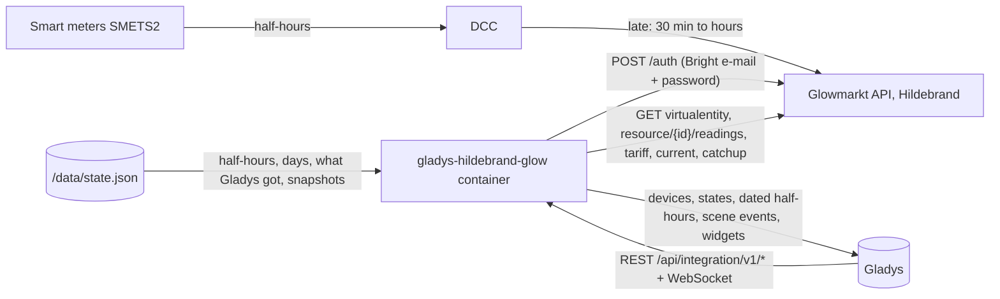
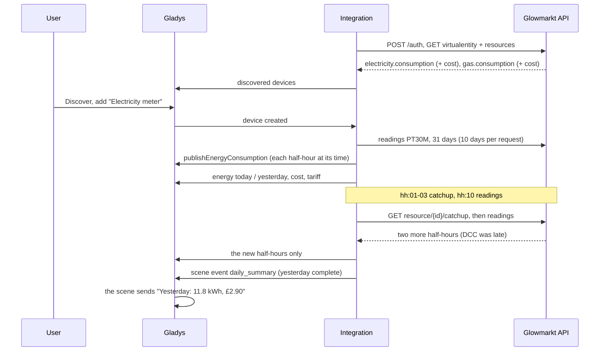
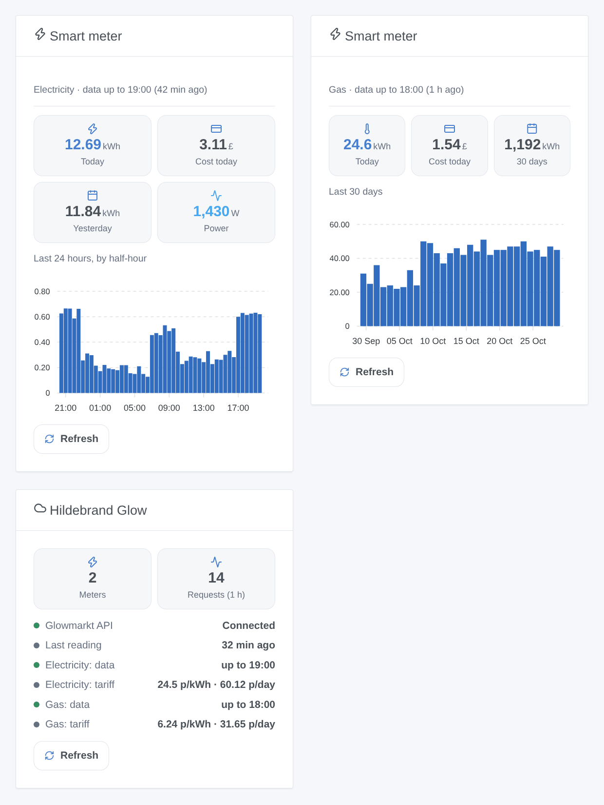

# Gladys Hildebrand Glow (DCC)

**English** · [Français](README.fr.md) · [Deutsch](README.de.md) · [Español](README.es.md)

[](LICENSE)
[](https://github.com/William-De71/gladys-hildebrand-glow/releases)
[](https://github.com/William-De71/gladys-hildebrand-glow/actions/workflows/release.yml)
[](https://gladysassistant.com)


[Gladys Assistant](https://gladysassistant.com) external integration for **British smart meters** (SMETS2, and SMETS1 on the DCC), read through **Glowmarkt**, the cloud of Hildebrand behind the free Bright app. One device per electricity and gas meter with the energy and the cost of the day, the tariff and the live power with a Glow display; the electricity half-hours land in the Gladys energy screens at their real time, however late the DCC delivers them.

User documentation: [English](docs/en.md) · [Français](docs/fr.md) · [Deutsch](docs/de.md) · [Español](docs/es.md).

Not affiliated with Hildebrand. **Not tested with a real Bright account yet**: the requests follow the official Swagger documents of the Glowmarkt API; the formats were cross-checked with [pyglowmarkt](https://github.com/cybermaggedon/pyglowmarkt) and the Home Assistant custom integration [ha-hildebrandglow-dcc](https://github.com/HandyHat/ha-hildebrandglow-dcc).

## Features

- **One device per meter** (electricity, gas): energy and cost of today and of yesterday, unit rate and standing charge in pounds, and the **power** when the account has a Glow display (IHD or CAD).
- **Dated half-hours**: the electricity half-hours go to the Gladys energy screens with `publishEnergyConsumption`, at their real time, never as an index (a late index would put hours of consumption in one half-hour); a corrected half-hour is published again; up to 90 days of history when the meter is added.
- **A light pace**: one `catchup` per meter just after each half-hour (as the Glowmarkt documentation asks, can be turned off), the readings 10 minutes later, meters and tariffs every 6 hours; 429 and outages slow down instead of insisting.
- **4 scene triggers**, **2 scene actions**, **2 dashboard widgets** (below) and a **Test the connection** button.
- Four languages everywhere: English, French, German, Spanish.

## How it works




From a meter to a scene:



### Transport

`transports: ["cloud"]`: every request goes to `api.glowmarkt.com` with the Bright account; the public `applicationId` of the Bright app identifies the client, like in the Glowmarkt documentation. The data come from the DCC, 30 minutes to a few hours late. A Glow display also has a local MQTT feed, not used here. `/data` keeps the half-hours of the last 3 days, the days of the last 70, the half-hours already given to Gladys and the values the scene triggers compare.

## Devices and features

| Feature                  | Category / type                                | Unit      | Present when                |
| ------------------------ | ---------------------------------------------- | --------- | --------------------------- |
| Consumption (half-hours) | `energy-sensor` / `thirty-minutes-consumption` | kWh       | electricity meter           |
| Energy today             | `energy-sensor` / `index-today`                | kWh       | always                      |
| Energy yesterday         | `energy-sensor` / `index-yesterday`            | kWh       | always                      |
| Cost today / yesterday   | `currency` / `decimal`                         | £         | the account has a cost      |
| Unit rate                | `currency` / `decimal`                         | £ per kWh | Bright knows a tariff       |
| Standing charge          | `currency` / `decimal`                         | £ per day | Bright knows a tariff       |
| Power                    | `energy-sensor` / `power`                      | W         | electricity, a Glow display |

All features are read-only. Gladys adds the cost of the 30-minute consumption itself, from your energy contract. The gas meter has no consumption feature: Gladys attaches every consumption to the main electric meter. Costs are given in pence by the API and published in pounds.

## Scene triggers, actions and widgets



Widgets:

- **Smart meter**: energy and cost of today, yesterday (or 7 / 30 days), power, bar chart by half-hour (24 h) or by day (7 / 30 days), how late the data are, **Refresh**. Settings: the meter, the chart.
- **Hildebrand Glow**: connection, how far the data of each meter go, tariffs, requests of the last hour, **Refresh**.

Scene triggers (filtered by meter and energy): the figures of yesterday are ready (energy, cost, complete), the tariff changes (new and previous rate and standing charge), a meter stops sending data (12 hours), a meter sends data again.

Scene actions: energy and cost of a period (today … last month), read the meters now (energy and cost of today, time of the latest data).

Examples:

- When the figures of yesterday are ready → notify "Yesterday: {{triggerEvent.data.energy_kwh}} kWh, £{{triggerEvent.data.cost}}".
- Every 1st of the month → get the energy and cost of last month and send them.
- When a meter stops sending data → notify to check the Bright app.

## Requirements

- Gladys Assistant **5.3.0** or later (older instances cannot install it).
- Smart meters on the DCC (SMETS2, or SMETS1 migrated), linked in the free Bright app, with the consumption visible there.
- Optional: a Glow display (IHD or CAD) for the live power.

## Installation

- **From the store**: Integrations → Hildebrand Glow (DCC) → Install.
- **From the repository URL**: Integrations → external integration → `https://github.com/William-De71/gladys-hildebrand-glow`.
- **Developer mode**: run `npm start` with the variables given by Gladys (see Development).

## Configuration

| Field or button              | Default   | Meaning                                                              |
| ---------------------------- | --------- | -------------------------------------------------------------------- |
| E-mail of the Bright account | —         | Required                                                             |
| Password                     | —         | Required, a secret: never shown again, never logged                  |
| Reading of the half-hours    | 30 min    | 30 or 60 minutes                                                     |
| Reading of the power         | 2 min     | 1, 2, 5 or 10 minutes, only with a Glow display                      |
| History given to Gladys      | 31 days   | 0, 7, 31 or 90 days, once per added meter                            |
| Ask for the latest data      | on        | One `catchup` per meter just after each half-hour                    |
| Language of the device texts | automatic | Meter and feature names, button messages                             |
| Test the connection          | —         | Signs in, reads the meters now and lists them with their latest data |

## Usage

1. Enter the e-mail and the password of the Bright account, then press **Test the connection** (Integrations → Hildebrand Glow (DCC) → Configuration).
2. **Discover**, then add the meters you want as devices.
3. Add the **Smart meter** and **Hildebrand Glow** widgets to a dashboard; the Gladys energy screens show the electricity half-hours.
4. Build scenes with the device features, the triggers and the actions.

## Development

```bash
npm install
npm test                       # node --test, never touches the network
npm run lint                   # ESLint
npm run format:check           # Prettier
npx github:GladysAssistant/integration-store . --skip-image-check
scripts/build-cover.sh         # cover.jpg from docs/assets/cover.svg
docs/illustrations/render.sh   # docs/assets/widgets.<lang>.png
```

Locally, the SDK reads `GLADYS_HOST_API_URL`, `GLADYS_INTEGRATION_TOKEN` and `GLADYS_INTEGRATION_SELECTOR` (given by Gladys in developer mode), and the integration reads `TZ` (the days; Europe/London when absent). `DEBUG=gladys-integration-sdk` shows the SDK logs.

The tests cover the API client (sign-in, headers, token renewal on `exp`, 401 and the 404 of an unknown token, 429 with Retry-After, 5xx, network errors, the readings query, the queue), the data model (meters from the classifiers, London days and clock changes, nulls, 10-day spans, both tariff shapes, current power), the devices (the fields the Discovery screen requires, category / type pairs, no index, no gas consumption), the scene triggers, the widgets (`validateWidgetContent`), the manifest, the four languages, the release script, and the whole integration against the fake Gladys of the SDK and a fake API (schedule, history, dated half-hours, errors, restart). `test/structure.test.js` freezes every key users store.

## Release process


Every merge on `main` runs the CI, then computes the version from the [Conventional Commits](https://www.conventionalcommits.org/) since the last tag: `feat` → minor, `fix` / `perf` → patch, `!` or `BREAKING CHANGE` → major (a minor below 1.0.0); `docs`, `chore`, `ci`, `test`, `style`, `refactor`, `build` alone publish nothing. The changelog section is generated, the tag pushed, the multi-architecture image built, then `main` receives the release commit, the GitHub Release is created and a last job checks the public image, the store validator and the topic.

- The pull request title becomes the squash commit, then the changelog line: write it in English, for the user (`pr-title.yml` checks it). Never edit `CHANGELOG.md` by hand.
- 1.0.0 is a decision: Actions → Release → Run workflow with `release-as: 1.0.0`. `dry-run` shows the version and the notes without publishing.
- **Protected branch**: the release pushes its commit to `main` with `GITHUB_TOKEN`. The `protect-main` ruleset (no deletion, no force-push) lets it through; a stricter rule (pull request required, status checks) would need GitHub Actions in its bypass list, or a GitHub App.
- After the first release, make the `ghcr.io` package public (Package settings → Change visibility), or Gladys cannot pull it.

## Troubleshooting

See [docs/en.md](docs/en.md#troubleshooting). Report issues with the versions of Gladys and of the integration, your meters (electricity, gas, SMETS1 / SMETS2, Glow display), the result of "Test the connection" and the logs of the integration. Never paste your password.

## Contributing

Issues and pull requests are welcome. Run `npm run format:check && npm run lint && npm test` before opening a pull request, and keep every external id and stored key unchanged (see [CLAUDE.md](CLAUDE.md)).

## Security

See [SECURITY.md](SECURITY.md): report vulnerabilities privately. The password is a `secret` field: never logged, never written to `/data`, sent only to `api.glowmarkt.com` over HTTPS to get a token; neither the token nor the password appears in an error message. Changing the password of the Bright account revokes the access at once.

## Screenshots to come

The images above are illustrations, not screenshots. Real screenshots will go in `docs/assets/screenshots/` (PNG, 1280 × 800): `configuration.png` (sign-in and "Test the connection"), `discovery.png`, `device.png` (the electricity meter), `energy.png` (the Gladys energy screen with the half-hours), `scene.png`.

## License

[Apache License 2.0](LICENSE) — see also [NOTICE](NOTICE). Hildebrand, Glow, Glowmarkt and Bright are trademarks of Hildebrand Technology Limited. The API facts come from the official Glowmarkt Swagger documents, [pyglowmarkt](https://github.com/cybermaggedon/pyglowmarkt) (Apache-2.0), [ha-hildebrandglow-dcc](https://github.com/HandyHat/ha-hildebrandglow-dcc) (MIT) and [glowmarkt-rs](https://github.com/Mossop/glowmarkt-rs) (MIT), credited in NOTICE; no code was copied. Thanks to the Gladys documentation and SDK.
